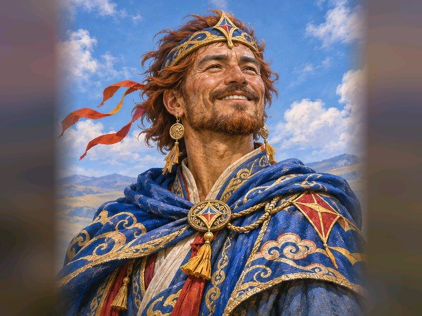

# Kingdom of a Thousand Kites

[Civilization gallery](../../docs/Civilizations.md)

Sky-King Aeral leads this human-only civilization from Windspire. Aeral's cities host great kite festivals on open plains. Windrunners read the banners overhead as easily as they read the land.

- **Children of the Open Sky**. Cities founded on Plains or Grassland gain +1 Production. Three adjacent plots of those underlying terrains grant +1 Culture.
- **Windrunner** replaces Horseman. +1 Movement and +10% strength when attacking units on Plains or Grassland.
- **Kite Pavilion** replaces Amphitheater. +1 Culture and +1 Gold in cities founded on Plains or Grassland.

The replacements inherit the active standalone Community Patch v151 definitions and approved companion effects. The pack includes original emblems, flags, portraits, diplomacy scenes, Dawn illustrations and setup maps. The replacement units and buildings inherit their in-world models. [Art and compilation notes](../docs/DailyExpansion_021_035_Art.md)

Native timing, combat and save acceptance remain outstanding.

[Canonical design](https://github.com/SolusGo/Weekly-civs/blob/main/Civilizations/023-kingdom-of-a-thousand-kites.md) · [Strategy](../docs/strategy/KingdomOfAThousandKites.md) · [Acceptance](TESTING.md)
