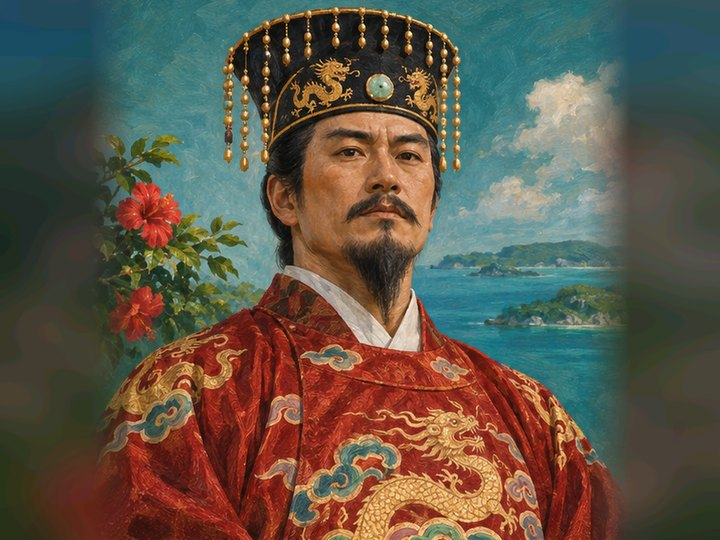

# Kingdom of Ryukyu

[Civilization gallery](../../docs/Civilizations.md)

Shō Shin leads this human-only civilization from Shuri. Inspired by the historical Ryukyuan kingdom and its East Asian maritime exchange. Shō Shin is a historical ruler. The uniques are gameplay abstractions.

- **The Maritime Kingdom**. Coastal cities gain +1 Gold and +1 Culture with any Harbor-class building.
- **Ryukyuan Guard** replaces Pikeman. +1 Sight and +15% defense in friendly territory.
- **Naha Trading Port** replaces Harbor. +2 Gold and +1 Science.

The replacements inherit the active standalone Community Patch v151 definitions and approved companion effects. The pack includes original emblems, flags, portraits, diplomacy scenes, Dawn illustrations and setup maps. The replacement units and buildings inherit their in-world models. [Art and compilation notes](../docs/DailyExpansion_021_035_Art.md)

Native timing, combat and save acceptance remain outstanding.

[Canonical design](https://github.com/SolusGo/Weekly-civs/blob/main/Civilizations/021-kingdom-of-ryukyu.md) · [Strategy](../docs/strategy/KingdomOfRyukyu.md) · [Acceptance](TESTING.md)
