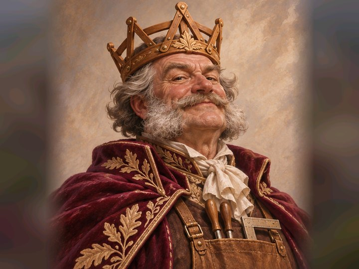

# The Grand Duchy of Folding Chairs

[Civilization gallery](../../docs/Civilizations.md)

Grand Duke Stackwell IV leads this human-only civilization from Seatopolis. A carpenter ended a succession dispute by offering every citizen a portable throne. Stackwell IV still asks visiting diplomats to take a seat.

- **The Right to Remain Seated**. A living, unembarked land combat unit garrisoned on its city's center grants +2 Culture and +1 Production. A city can receive the bonus once.
- **Chair Marshal** replaces Spearman. +1 Sight and the installed Community Patch Cover I promotion. Both inherit through normal upgrades.
- **Grand Assembly Hall** replaces Walls. +1 Culture and +1 Gold when an eligible land garrison is present.

The replacements inherit the active standalone Community Patch v151 definitions and approved companion effects. The pack includes original emblems, flags, portraits, diplomacy scenes, Dawn illustrations and setup maps. The replacement units and buildings inherit their in-world models. [Art and compilation notes](../docs/DailyExpansion_021_035_Art.md)

Native timing, combat and save acceptance remain outstanding.

[Canonical design](https://github.com/SolusGo/Weekly-civs/blob/main/Civilizations/033-the-grand-duchy-of-folding-chairs.md) · [Strategy](../docs/strategy/TheGrandDuchyOfFoldingChairs.md) · [Acceptance](TESTING.md)
