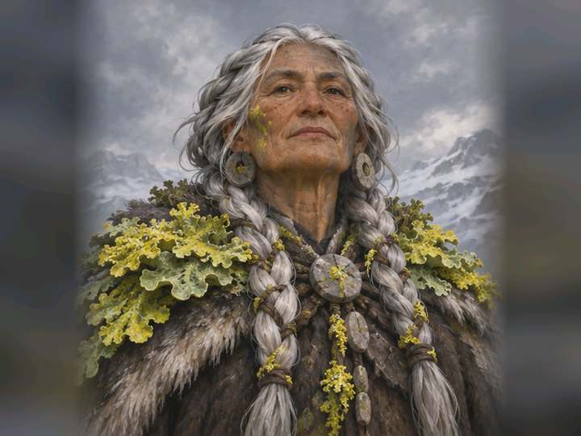

# The Lichen Compact

[Civilization gallery](../../docs/Civilizations.md)

Elder Thallia leads this human-only civilization from Symbiosis. Thallia's settlements survive the long cold by treating mutual dependence as a strength. Lichen symbiosis informs their horticulture and civic life.

- **The Art of Endurance**. +1 Food per worked Tundra (up to +4) and +1 Science per worked Snow (up to +3) per city. +1 Culture in cities founded on Tundra or Snow.
- **Stonewalker** replaces Scout. +1 Sight and double movement on Tundra and Snow. The unique bonuses persist through upgrades.
- **Symbiotic Garden** replaces Granary. +1 Food; +1 Science with three owned cold plots within three hexes and +1 Culture with six.

The replacements inherit the active standalone Community Patch v151 definitions and approved companion effects. The pack includes original emblems, flags, portraits, diplomacy scenes, Dawn illustrations and setup maps. The replacement units and buildings inherit their in-world models. [Art and compilation notes](../docs/DailyExpansion_021_035_Art.md)

Native timing, combat and save acceptance remain outstanding.

[Canonical design](https://github.com/SolusGo/Weekly-civs/blob/main/Civilizations/029-the-lichen-compact.md) · [Strategy](../docs/strategy/TheLichenCompact.md) · [Acceptance](TESTING.md)
