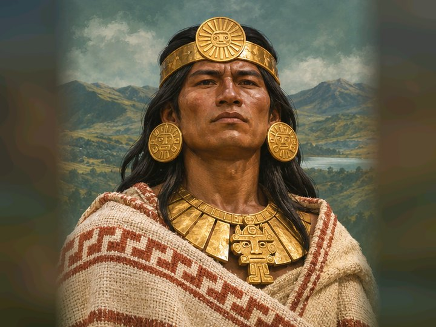

# The Muisca Confederation

[Civilization gallery](../../docs/Civilizations.md)

Zipa Tisquesusa leads this human-only civilization from Bacatá. Inspired by the Muisca network of highland chiefdoms in present-day Colombia and by its salt trade, metalworking and sacred lakes. The uniques are fictionalized gameplay abstractions.

- **The Sacred Exchange**. Working an owned, improved, unpillaged Gold or Silver tile grants +2 Faith and +1 Culture. Owning an actual Lake tile within three hexes grants +1 Gold. Each bonus is binary.
- **Guecha Warrior** replaces Spearman. +1 Sight and +15% defense on Hills. Both unique bonuses persist through upgrades.
- **Salt Exchange** replaces Market. +1 Faith. +1 Gold per worked, owned, unpillaged Mine, capped at +2.

The replacements inherit the active standalone Community Patch v151 definitions and approved companion effects. The pack includes original emblems, flags, portraits, diplomacy scenes, Dawn illustrations and setup maps. The replacement units and buildings inherit their in-world models. [Art and compilation notes](../docs/DailyExpansion_021_035_Art.md)

Native timing, combat and save acceptance remain outstanding.

[Canonical design](https://github.com/SolusGo/Weekly-civs/blob/main/Civilizations/032-the-muisca-confederation.md) · [Strategy](../docs/strategy/TheMuiscaConfederation.md) · [Acceptance](TESTING.md)
