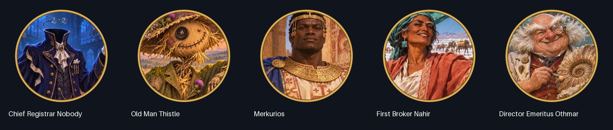

# Original art for the five archived civilizations

This visual update replaces the four native presentation fallbacks and redesigns the Directorate. Each civilization receives **six independent original illustrations**: leader, civilization emblem, unique unit, unique building, Dawn scene and capital panorama. Thirty masters compile into **285 DDS assets** across these five civilizations, with **411 DDS assets in the full pack**. Static diplomacy scenes, icons and flags are custom; native unit/building world models and audio remain inherited.

## Memorable leader identities

| Civilization | Character design | Palette and visual vocabulary |
| --- | --- | --- |
| Department of Lost Things | Nobody is a headless spectral registrar: empty high collar, floating spectacles, detached ivory gloves and oversized scarlet stamp. | Nocturnal indigo, scarlet seals, antique brass, keys, luggage tags and impossible filing-cabinet architecture. |
| Assembly of Scarecrows | Thistle is a crooked living scarecrow with mismatched button/seed eyes, straw whiskers, a thistle-covered hat and a crow. | Harvest gold, moss green, purple thistle, woven wicker, wheat and bronze bells. |
| Kingdom of Makuria | Merkurios is a broad, clean-shaven Nubian king with short coiled hair, a cross diadem and ivory/red-ochre robes. | Ivory, terracotta and lapis; Nubian Christian murals, fortified walls, bows and the Nile. |
| The Salt Road Compact | Nahir is a formidable older merchant matriarch with a knowing smile, low turquoise wrap, white eyebrow streak and brass scales. | Turquoise, coral and salt white; luminous salt crystals, balances, caravan arcades and camels. |
| The Paleontological Directorate | Othmar is a stout bald scholar with wild white side-whiskers, enormous monocle, vermilion waistcoat and an ammonite held like a treasured pet. | Celadon, fossil ivory, copper and vermilion; cabinet lamps, geological strata, glass museum roofs and fossil skeletons. |



The leader scenes deliberately vary age, face shape, species, body shape, silhouette, expression, costume and lighting. The gold rims provide continuity with the pack's presentation. These are original character illustrations rather than edits of the old leader face or repeated generic portraits. Nahir's matriarch design is a new fictional visual interpretation; the archive establishes the leader's name/title rather than a fixed portrait.

Makuria's visual direction was informed by the [National Museum in Warsaw's Faras Gallery](https://mnw.pl/en/about-the-museum/permanent-galleries/faras-gallery) and [University of Warsaw's Old Dongola wall-painting research](https://pcma.uw.edu.pl/wp-content/uploads/2023/04/PR_Nowe-odkrycia-w-Starej-Dongoli_ENG.pdf). These primary sources support the Nubian Christian artistic setting. The generated portrait, costume and city views are stylized interpretations, not a verified likeness of Merkurios, a precise reconstruction or copied museum artwork. Fictional heraldry is explicitly game art.

## Delivered assets and rebuild

Each civilization has 57 DDS files:

- Civilization emblem, leader portrait, unique unit portrait and unique building portrait, all gold-rimmed with transparent exterior corners.
- Original monochrome civilization-alpha and unit-flag glyphs: keyhole-tag, bell/wheat, cross/walls, scales and ammonite.
- Each of those six atlas families at 256, 128, 80, 64, 48, 45, 32, 24 and 16 pixels, with full mip chains: **54 icon DDS files**.
- Separate 1600×1200 diplomacy illustration, 1024×768 Dawn scene and 360×412 capital illustration: **three scene DDS files**. Dawn and capital each have their own master; they are not reused leader crops.

The 30 original PNG masters live in each civilization's `Art/Sources` directory. `Prompts.json` retains each exact final built-in image_gen prompt and transparency setting. `Provenance.json` records source hashes and the tool used. No API/CLI image-generation fallback, stock artwork or API key was used. `tools/daily_art_prompts.json` contains the complete prompt set. The deterministic compiler needs only the retained PNGs and the existing Pillow dependency.

```powershell
python tools/generate_archived.py
python tools/generate_paleo.py
python tools/build_daily_art.py
python tools/build_mod.py --package
python tools/validate_mod.py --compare-database "$env:USERPROFILE\Documents\My Games\Sid Meier's Civilization 5\cache\Civ5DebugDatabase.db"
```

`build_daily_art.py --civ LOST|SCARECROW|MAKURIA|SALT|PALEO` rebuilds one set. The existing `build_paleo_art.py` command remains a compatibility entry point. PNG master/review files stay outside the installable resource list, following the pack's existing source-art convention; compiled DDS and leader-scene XML are included/imported. A full visual review is retained at `docs/ArtReview/ArchivedLeaders.png`.

## Integration and verification

Four additional art SQL actions bring the pack to **49 unique database activation actions**, with the same ten gameplay contexts. Civilization/leader/unit/building atlases, custom flags, Dawn/map images and static LeaderScene XML all use unique names. The five sets share no leader portrait, original illustration or flag glyph with each other. The original five civilizations' art and gameplay files are untouched. Gameplay Lua, yield rules, native baseline inheritance, GUID, version, dependencies and save record formats are unchanged by this update; edited scalar values are presentation fields and player colors only.

`validate_daily_art.py` checks all 30 source hashes/prompts, image dimensions and emblem transparency, every atlas size/registration, DDS headers/payload/mips, monochrome glyphs, five distinct leader/flag hashes, VFS imports and all 285 outputs. Recompilation must reproduce DDS/scene XML/art SQL bytes exactly. The existing clean-schema, mutated-baseline, Lua51, gameplay-regression and ZIP checks continue in the full validator. Actual run results are recorded in `tools/Validation.json` after rebuilding.

The source illustrations and compiled review sheets are visually inspected for distinct characters, readable portrait crops, palette consistency and icon silhouettes. **Native Civilization V rendering and gameplay acceptance have not been run.** Static inspection/package checks cannot establish actual in-game leader-screen framing, map-flag tinting, compression-driver behavior or UI mod compatibility. Diplomacy is a static illustrated scene; this update does not add animated 3D leader models, new world models or voice recordings.
