# Cool Wacky Civs 3 civilization gallery

[Collection README](../README.md) · [Installation](../Wacky3/README.md#installation) · [Artwork credits](artwork/README.md)

Select a civilization to read its guide. Each preview shows the leader’s diplomacy artwork.

## Original roster

<table>
  <tr>
    <td width="33%" valign="top">
      <a href="../Wacky3/TheMinistryOfAlmost/README.md"> <strong>The Ministry of Almost</strong></a> 
      Acting Chancellor Penultimate 
      Gain Science and Culture while behind in technology
    </td>
    <td width="33%" valign="top">
      <a href="../Wacky3/TheHollowChoir/README.md">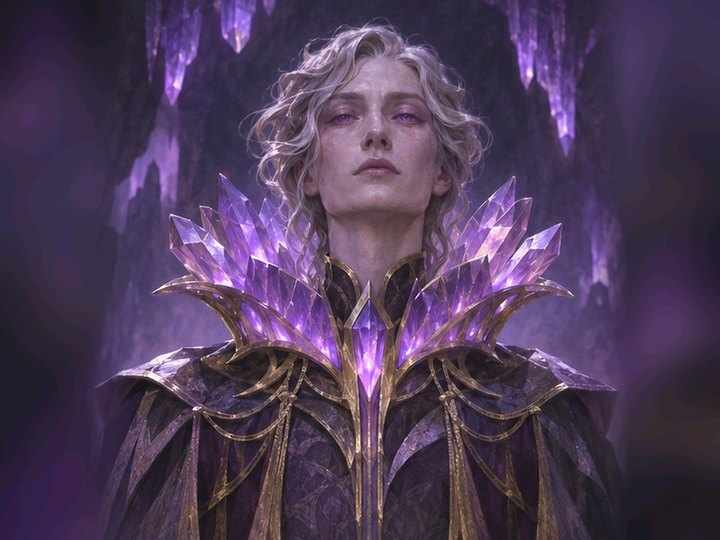 <strong>The Hollow Choir</strong></a> 
      The First Note 
      Settle Hills near Mountains for Faith and Science
    </td>
    <td width="33%" valign="top">
      <a href="../Wacky3/TheSeventeenthSummer/README.md">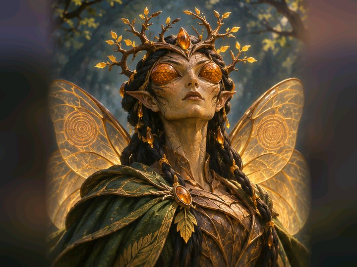 <strong>The Seventeenth Summer</strong></a> 
      Chorus-Mother Ixa 
      Alternate growth and production through a brood cycle
    </td>
  </tr>
  <tr>
    <td width="33%" valign="top">
      <a href="../Wacky3/ThePerpetualTimetable/README.md"> <strong>The Perpetual Timetable</strong></a> 
      Grand Stationmaster Veyl 
      Connect cities and upgrade the network to rail
    </td>
    <td width="33%" valign="top">
      <a href="../Wacky3/TheCandlekeepersCovenant/README.md"> <strong>The Candlekeeper&#x27;s Covenant</strong></a> 
      High Keeper Seraphine 
      Remember lost cities with defensive play and Culture
    </td>
    <td width="33%" valign="top">
      <a href="../Wacky3/ThePaleontologicalDirectorate/README.md">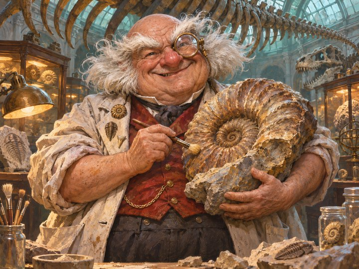 <strong>The Paleontological Directorate</strong></a> 
      Director Emeritus Othmar 
      Build Libraries and Universities and excavate sites
    </td>
  </tr>
  <tr>
    <td width="33%" valign="top">
      <a href="../Wacky3/TheDepartmentOfLostThings/README.md"> <strong>Department of Lost Things</strong></a> 
      Chief Registrar Nobody 
      Turn nearby victories into city collections of Curios
    </td>
    <td width="33%" valign="top">
      <a href="../Wacky3/TheAssemblyOfScarecrows/README.md"> <strong>Assembly of Scarecrows</strong></a> 
      Old Man Thistle 
      Develop farmland for Culture, Production, and Food
    </td>
    <td width="33%" valign="top">
      <a href="../Wacky3/TheKingdomOfMakuria/README.md">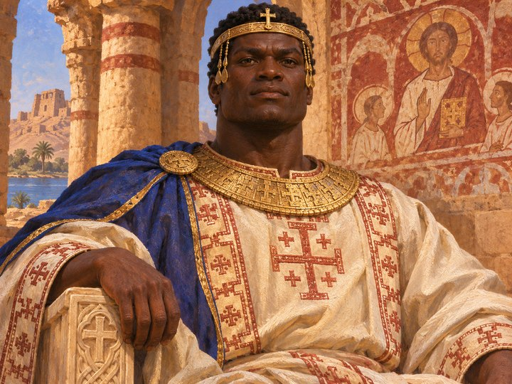 <strong>Kingdom of Makuria</strong></a> 
      Merkurios 
      Use Walls and Painted Churches for Culture and Faith
    </td>
  </tr>
  <tr>
    <td width="33%" valign="top">
      <a href="../Wacky3/TheSaltRoadCompact/README.md">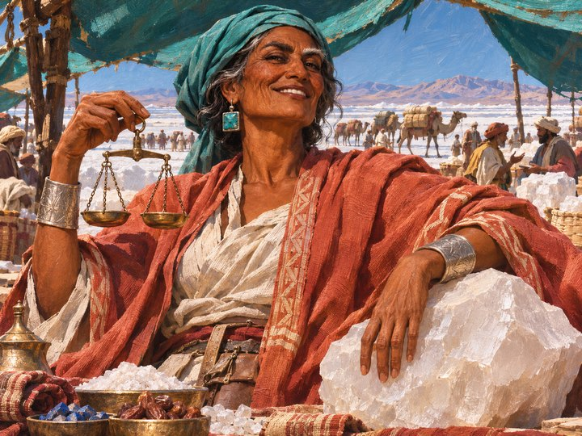 <strong>The Salt Road Compact</strong></a> 
      First Broker Nahir 
      Use outbound land trade to develop origin cities
    </td>
    <td width="33%"></td>
    <td width="33%"></td>
  </tr>
</table>

## Daily Surprise expansion and The Qu

<table>
  <tr>
    <td width="33%" valign="top">
      <a href="../Wacky3/KingdomOfRyukyu/README.md">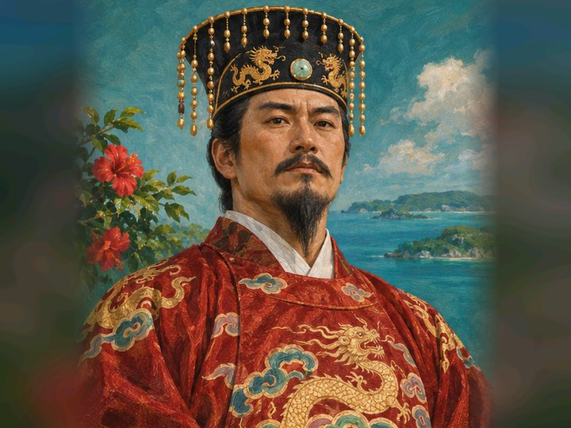 <strong>Kingdom of Ryukyu</strong></a> 
      Shō Shin 
      Maritime trade and Harbor development
    </td>
    <td width="33%" valign="top">
      <a href="../Wacky3/TheMirrorboundRepublic/README.md">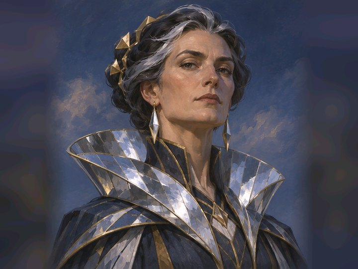 <strong>The Mirrorbound Republic</strong></a> 
      First Reflector Caelis 
      Turn combat losses into lessons for defenders
    </td>
    <td width="33%" valign="top">
      <a href="../Wacky3/KingdomOfAThousandKites/README.md">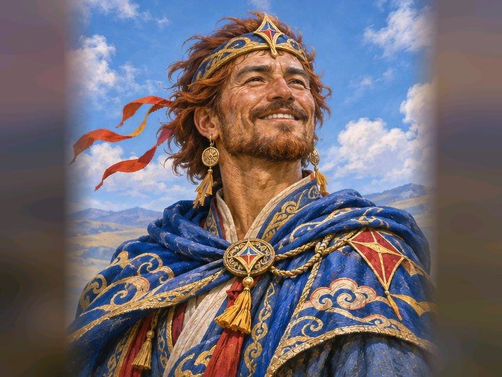 <strong>Kingdom of a Thousand Kites</strong></a> 
      Sky-King Aeral 
      Settle open plains and fight around favorable terrain
    </td>
  </tr>
  <tr>
    <td width="33%" valign="top">
      <a href="../Wacky3/ThePostalSovereignty/README.md">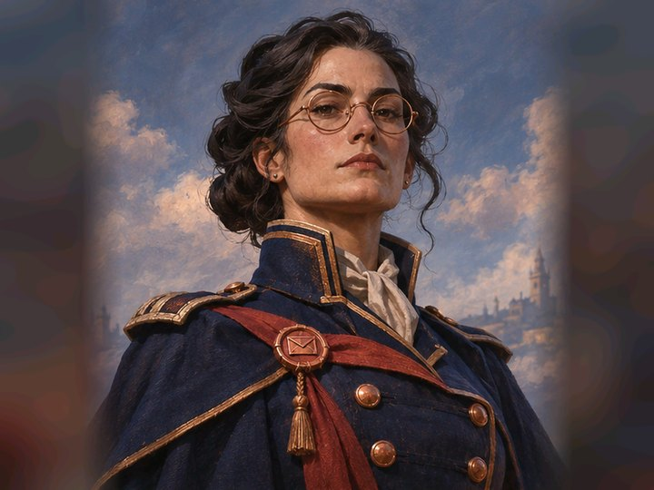 <strong>The Postal Sovereignty</strong></a> 
      Postmaster-General Elowen 
      Build a network of Post Offices and move through friendly land
    </td>
    <td width="33%" valign="top">
      <a href="../Wacky3/TheCarapaceDominion/README.md">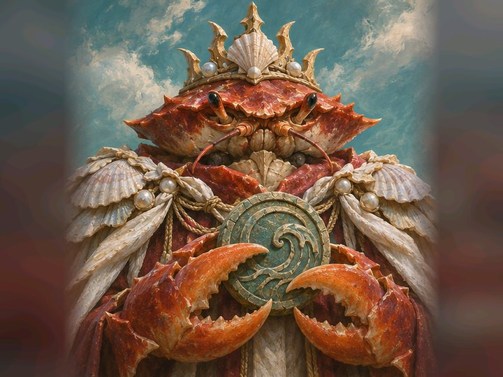 <strong>The Carapace Dominion</strong></a> 
      High Claw Thalassar 
      Coastal fortifications and Walls-class Science
    </td>
    <td width="33%" valign="top">
      <a href="../Wacky3/TheOctopusParliament/README.md"> <strong>The Octopus Parliament</strong></a> 
      Speaker Eightfold 
      Choose a parliamentary resolution each era
    </td>
  </tr>
  <tr>
    <td width="33%" valign="top">
      <a href="../Wacky3/TheFogboundRepublic/README.md"> <strong>The Fogbound Republic</strong></a> 
      First Warden Mirelle 
      Grow and defend cities around Marsh
    </td>
    <td width="33%" valign="top">
      <a href="../Wacky3/TheRepublicOfBorrowedTomorrows/README.md"> <strong>The Republic of Borrowed Tomorrows</strong></a> 
      Chancellor Aevra Voss 
      Friendly-territory defense and Market yields
    </td>
    <td width="33%" valign="top">
      <a href="../Wacky3/TheLichenCompact/README.md">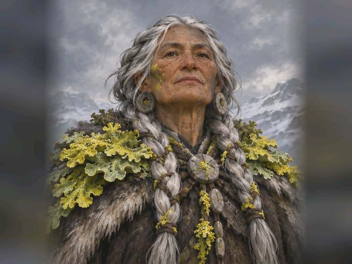 <strong>The Lichen Compact</strong></a> 
      Elder Thallia 
      Develop cold terrain and settle Tundra and Snow
    </td>
  </tr>
  <tr>
    <td width="33%" valign="top">
      <a href="../Wacky3/TheGlassOrchard/README.md">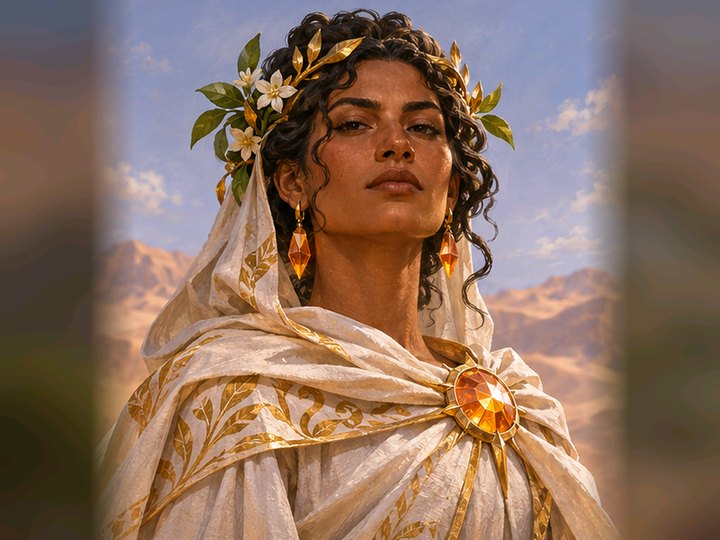 <strong>The Glass Orchard</strong></a> 
      First Gardener Solenne 
      Develop Desert cities and defend the orchards
    </td>
    <td width="33%" valign="top">
      <a href="../Wacky3/TheCartographersOfNowhere/README.md"> <strong>The Cartographers of Nowhere</strong></a> 
      Grand Surveyor Elian Vey 
      Explore the map and build up Atlas Houses
    </td>
    <td width="33%" valign="top">
      <a href="../Wacky3/TheMuiscaConfederation/README.md">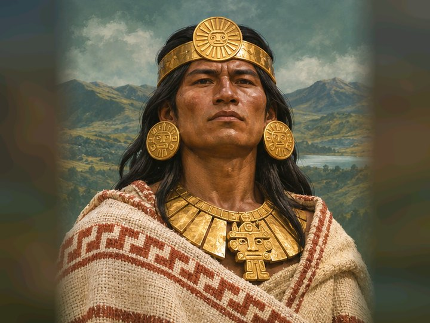 <strong>The Muisca Confederation</strong></a> 
      Zipa Tisquesusa 
      Work precious-metal and Iron Mines near highland Lakes
    </td>
  </tr>
  <tr>
    <td width="33%" valign="top">
      <a href="../Wacky3/TheGrandDuchyOfFoldingChairs/README.md">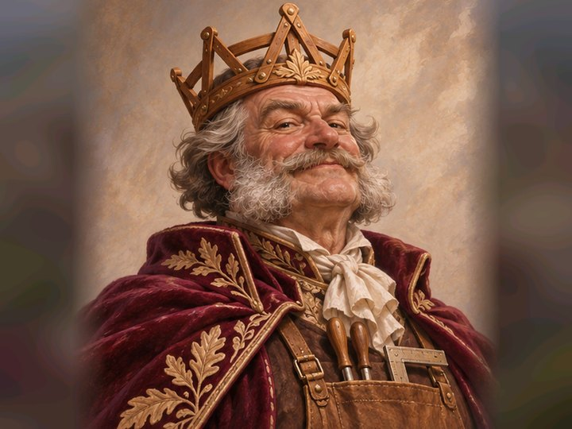 <strong>The Grand Duchy of Folding Chairs</strong></a> 
      Grand Duke Stackwell IV 
      Use land garrisons to sustain city yields
    </td>
    <td width="33%" valign="top">
      <a href="../Wacky3/TheChachapoya/README.md"> <strong>The Chachapoya</strong></a> 
      Guardian Yana 
      Settle Hills and defend walled cities
    </td>
    <td width="33%" valign="top">
      <a href="../Wacky3/TheCalendarOfUnofficialHolidays/README.md"> <strong>The Calendar of Unofficial Holidays</strong></a> 
      Minister Pippa Day 
      Time city development around celebrations
    </td>
  </tr>
  <tr>
    <td width="33%" valign="top">
      <a href="../Wacky3/TheQu/README.md">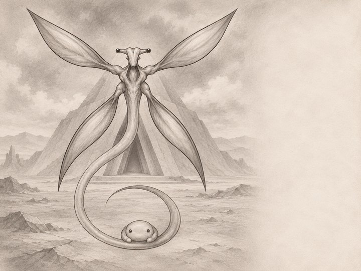 <strong>The Qu</strong></a> 
      The First Architect 
      Earn Biomass in combat and specialize annexed cities
    </td>
    <td width="33%"></td>
    <td width="33%"></td>
  </tr>
</table>
